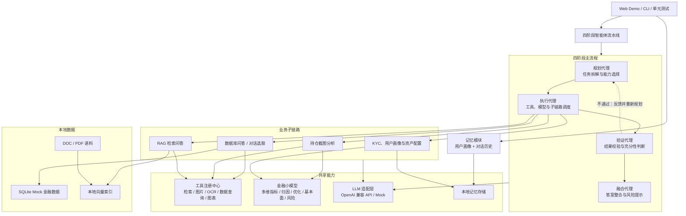
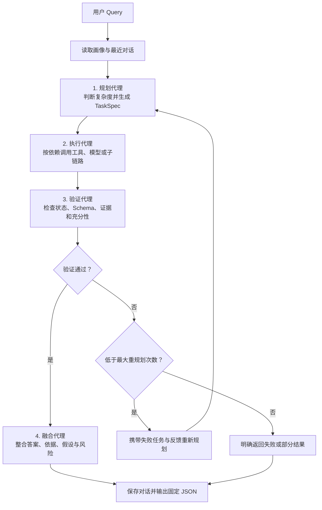
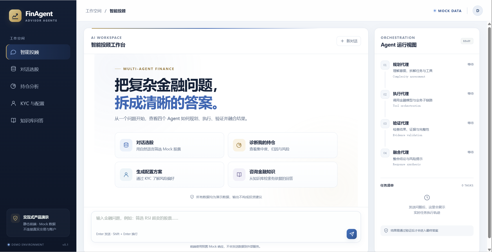
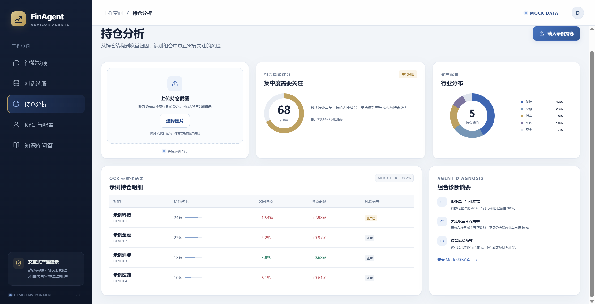
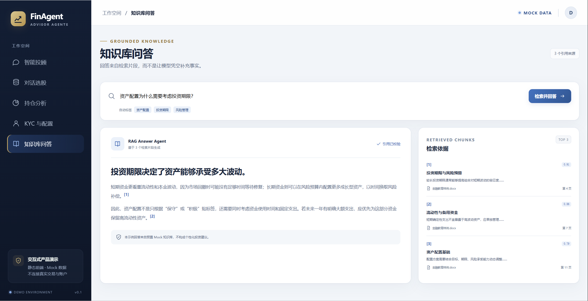

# Financial AI Advisor Agents

一个面向个人学习与技术作品集的**多智能体金融问答系统独立重实现**。项目围绕“规划—执行—验证—融合”四阶段流水线，组织数据库问答、持仓分析、KYC 用户画像和 RAG 四条子链路，并演示大模型与确定性金融小模型的协同方式。

**项目地址**：[github.com/MEIQI-Lee/financial-ai-advisor-agents](https://github.com/MEIQI-Lee/financial-ai-advisor-agents)<br>
**作者主页**：[MEIQI-Lee](https://github.com/MEIQI-Lee)<br>
**开源许可**：MIT License

> 文件状态：【完整可运行】（README 文档已完成）<br>
> Web Demo：【完整可运行】（静态交互界面，使用固定 Mock 数据）<br>
> 核心后端：【完整可运行】（四阶段流水线、数据库问答、记忆模块，29 项测试通过）<br>
> 其余业务模块：【骨架待补充】（持仓、KYC、RAG 与金融小模型）<br>
> Web 界面和 Python 核心均已可运行；当前 Web 使用独立 Mock 数据，尚未连接 Python 后端。

## 目录

- [项目背景](#项目背景)
- [设计目标](#设计目标)
- [核心架构](#核心架构)
- [四阶段主流程](#四阶段主流程)
- [功能范围与实现状态](#功能范围与实现状态)
- [子链路说明](#子链路说明)
- [大小模型协同](#大小模型协同)
- [提示词设计范式](#提示词设计范式)
- [项目结构](#项目结构)
- [Web 交互 Demo](#web-交互-demo)
- [快速开始](#快速开始)
- [Demo 占位](#demo-占位)
- [测试与独立运行](#测试与独立运行)
- [数据与隐私](#数据与隐私)
- [合规与免责声明](#合规与免责声明)
- [实现路线](#实现路线)
- [参考与致谢](#参考与致谢)

## 项目背景

本项目是对实习期间参与过的“大模型投顾”方向项目进行的**个人学习性质独立重实现**。

- 与原雇主或任何公司均无关联，不代表任何公司的产品或技术方案。
- 不使用原项目源代码、内部链接、内部截图或不可公开的方案原文。
- 功能范围仅依据已抽象整理的需求规格，代码、提示词和 Mock 数据均重新设计。
- 项目不包含真实交易、券商账户连接、实盘行情承诺或收益保证。

## 设计目标

- **四阶段闭环**：任务可以经过验证后退回重新规划，而不是一次性串联多个 Agent。
- **Agent 可独立测试**：每个 Agent 都具有明确输入、固定 JSON 输出和最小单元测试。
- **大小模型分工**：LLM 负责推理和生成，金融小模型负责可复核的定量计算。
- **提示词与代码分离**：所有提示词集中在 `prompts/`，遵循统一结构和输出约束。
- **默认可离线演示**：通过 Mock LLM、Mock OCR、SQLite 和虚构金融数据降低运行门槛。
- **可替换模型提供方**：通过 OpenAI 兼容 API 接入 LLM，密钥仅从环境变量读取。
- **结果有据可查**：SQL、检索片段和模型中间结果作为证据进入验证与融合阶段。

## 核心架构



### 模块边界

| 模块 | 主要职责 |
|---|---|
| 四阶段流水线 | 规划、执行、验证、重规划和最终融合 |
| 数据库问答 | Query 扩写、实体对齐、Text2SQL、查询与图表生成 |
| 持仓分析 | OCR 持仓提取、归因、风险诊断和组合优化建议 |
| KYC 与画像 | 标准化多轮问答、画像更新和教育性资产配置 |
| RAG | 文档切分、向量化、标签过滤、检索与带引用回答 |
| 工具注册中心 | 统一注册检索、图片、OCR、数据库和图表工具 |
| 金融模型 | 输出可重复计算的专项指标，不承担自然语言生成 |
| 记忆模块 | 保存明确填写的用户画像与有限对话历史 |

## 四阶段主流程



| Agent | 输入 | 输出 | 责任边界 |
|---|---|---|---|
| 规划代理 | Query、画像、历史、能力清单、修正反馈 | `Plan` | 只选择已注册能力，不伪造工具或数据 |
| 执行代理 | Plan、前序任务结果 | `TaskResult[]` | 按依赖执行并记录证据，不自行改变任务目标 |
| 验证代理 | Query、Plan、TaskResults | `ValidationResult` | 决定进入融合或退回规划，不修补业务数据 |
| 融合代理 | 已验证任务结果 | `FinalResponse` | 不调用新工具，不使用未通过验证的结论 |

默认最大重规划次数为 `2`。重试耗尽后必须返回未完成原因，不能为了生成完整回答而编造结果。

## 功能范围与实现状态

| 功能 | 范围 | 当前状态 |
|---|---|---|
| Web 交互 Demo | 五个业务页面、Mock 图表、KYC 交互和 Agent 轨迹 | 【完整可运行】 |
| 四阶段主流程 | 规划、执行、验证、重规划、融合 | 【完整可运行】【需自研理解】 |
| 数据库问答 | Query 扩写、指标抽取、Text2SQL、执行、后处理 | 【完整可运行】【需自研理解】 |
| 对话选股 | 内部任务规划、语义分析、SQL 生成与执行 | 【完整可运行】 |
| 持仓分析 | Mock/PaddleOCR、归因、风险、诊断与优化 | 【骨架待补充】 |
| KYC 与画像 | SOP 问答、画像更新、市场环境和资产配置 | 【骨架待补充】 |
| RAG | 离线索引、在线标签检索和引用回答 | 【骨架待补充】 |
| 金融小模型 | 多维指标、归因、组合优化、基本面、风险 | 【骨架待补充】 |
| 记忆模块 | 用户画像与对话历史持久化 | 【完整可运行】 |

## 子链路说明

### 1. 数据库问答与对话选股

目标链路：

```text
Query 扩写
  → 对话选股任务规划
  → 指标实体抽取
  → 数据库实体对齐 + 最小 Schema 拼接
  → Text2SQL
  → SQL 安全校验与执行
  → 数据后处理与图表生成
```

对话选股内部保持五个顶层组件：

1. 任务规划代理；
2. 语义分析代理；
3. Text2SQL 代理；
4. SQL 执行代理；
5. 数据后处理。

指标实体抽取器作为语义分析内部的 NLP 组件。SQL 执行层使用 AST 校验限制为**单条只读 SELECT**，并校验表字段白名单和返回行数。

示例问题：

```text
筛选出 RSI 超卖且均线多头排列的股票，并整理为表格。
```

所有查询默认针对虚构 SQLite 数据，结果不能解释为真实市场行情。

### 2. 持仓分析

目标链路：

```text
持仓截图
  → 图片校验
  → Mock OCR 或 PaddleOCR
  → 持仓字段标准化
  → 低置信度字段标记
  → 多维指标 / 归因 / 风险模型
  → 可选组合优化
  → 诊断报告与优化建议
```

OCR 未确认的证券名称、数量或成本必须保留为空值或待确认状态，不允许猜测补齐。

### 3. KYC、用户画像与资产配置

标准化问答范围：

- 基本信息；
- 投资经验；
- 风险承受能力；
- 支出流向；
- 固定支出占比。

目标链路：

```text
SOP 多轮问答
  → 画像字段增量更新
  → 完整性检查
  → 市场环境分析
  → 金融小模型与配置约束
  → 股票 / 基金 / 现金等资产类别配置方案
```

市场环境输出固定为：

```json
{"economic_cycle":"","market_interest_rate":"","policies_and_regulations":""}
```

画像字段只能由用户明确回答更新，普通聊天历史不能自动改变风险承受能力。

### 4. RAG

离线流程：

```text
DOC / PDF → 文本提取 → 文本切分 → 向量化 → 本地向量索引
```

在线流程：

```text
用户问题 → 受控标签获取 → Query 向量化
→ 标签过滤与相似度检索 → Top-K 证据片段 → 带引用答案
```

检索证据不足时应明确说明不足，不使用模型记忆补造语料中不存在的事实。

## 大小模型协同

| 大模型负责 | 小模型或确定性程序负责 |
|---|---|
| 意图理解与复杂度判断 | SQL 安全校验和 SQLite 执行 |
| 任务规划与 Query 扩写 | 数据库实体匹配与 Schema 裁剪 |
| 指标实体抽取与语义理解 | OCR 推理与持仓字段解析 |
| 充分性判断和最终答案融合 | 指标、归因、风险和组合优化计算 |
| RAG 标签获取与答案生成 | 文档切分、向量化和相似度检索 |

金融模型输出应包含输入摘要与关键中间值，避免大模型自行推算或改写数值。

## 提示词设计范式

所有提示词集中放在 `prompts/`，与 Python 代码分离，并统一采用：

```text
#角色
#任务步骤
输出格式参考
#任务要求
```

共同要求：

1. 输出固定 JSON，不使用 Markdown 代码块包裹；
2. 未提及的字段按 Schema 输出空值；
3. 只提取清单中已经列出的实体，未列出的不提取；
4. 不增加 Schema 之外的字段；
5. JSON 解析或 Pydantic 校验失败时，不将原始文本直接传入下游。

指标实体范围包括规格定义的基本面指标与技术面指标，例如资产负债率、毛利率、每股收益率、股息率、MACD 金叉、布林线轨道、均线多头排列和 RSI 超卖等。

## 项目结构

以下为核心目录摘要；持仓、KYC、RAG 等未实现目录暂未创建。

```text
financial-ai-advisor-agents/
├── configs/                         # 应用配置与金融 Schema
├── data/mock/                       # 虚构证券与指标数据
├── docs/screenshots/                # 智能投顾、持仓分析与知识库问答实拍图
├── prompts/                         # 当前 LLM Agent 提示词
├── web/                             # 可直接运行的静态 Web 交互 Demo
│   ├── index.html                   # 五个业务场景与 Agent 运行视图
│   ├── styles.css                   # 响应式金融科技风格界面
│   ├── app.js                       # Mock 交互、状态时间线与 KYC 逻辑
│   └── preview.png                  # 浏览器实际渲染的首页预览图
├── src/financial_ai_advisor_agents/
│   ├── agents/                      # 四阶段主 Agent
│   ├── workflows/                   # 主流程编排与有限重规划
│   ├── database/                    # Schema 注册、SQL AST 防护和 SQLite
│   ├── database_qa/                 # 数据库问答与对话选股
│   ├── tools/                       # 能力注册与类型校验
│   ├── memory/                      # 用户画像与对话历史
│   ├── llm/                         # OpenAI 兼容 API 与 Mock
│   ├── schemas/                     # Pydantic 数据契约
│   ├── app.py                       # 依赖组装与能力注册
│   └── cli.py                       # 主流程、数据库与独立 Agent 入口
├── examples/                        # 主流程、数据库与独立 Agent Demo
├── scripts/                         # Mock 数据初始化
└── tests/                           # Agent 单测与链路集成测试
```

## Web 交互 Demo

`web/` 提供一个无需安装 npm 依赖的响应式前端，采用深海军蓝、金融蓝与香槟金配色，可直接展示项目的使用方式与多智能体编排过程。以下图片均为当前静态 Demo 的实际浏览器渲染效果，业务数据为虚构 Mock 数据。

### 智能投顾工作台

展示四阶段 Agent 时间线、任务清单、预置业务入口与金融问题输入区。



### 持仓分析

展示 Mock OCR 状态、组合风险评分、行业配置环图、持仓明细与诊断摘要；当前未执行真实 OCR 或组合优化。



### 知识库问答

展示检索标签、回答正文、相似度和引用片段；当前为预置交互演示，尚未连接真实向量索引。



### 页面与交互

- **智能投顾工作台**：输入问题或点击预置示例，动态查看规划、执行、验证、融合四阶段时间线、任务清单和最终 Mock 答案。
- **对话选股**：展示指标实体、Text2SQL、RSI 柱状图、股票表格和链路追踪。
- **持仓分析**：展示持仓上传入口、Mock OCR 状态、行业配置环图、风险评分、持仓明细和优化方向。
- **KYC 与配置**：完成三道交互问题，实时更新风险画像、完成进度和资产比例预览；支持重新演示。
- **知识库问答**：展示检索标签、回答正文、相似度和可追溯引用片段。

界面仅使用 HTML、CSS 和原生 JavaScript，所有业务结果均为固定 Mock 内容。选择本地图片不会上传文件，也不会执行真实 OCR。当前 Web 尚未连接已实现的 Python 核心；后续应通过 HTTP API 将 `web/app.js` 中的模拟执行替换为真实流水线调用。

### 启动 Web Demo

在项目根目录执行：

```bash
python -m http.server 8000 --directory web
```

浏览器访问 `http://localhost:8000`。也可以使用任意静态文件服务器托管 `web/`。

## 快速开始

以下命令适用于已实现的四阶段流水线、数据库问答和独立 Agent。默认 `mock` 模式不需要 API Key，也不会调用外部 LLM。

### 环境要求

- Python 3.10+
- Git
- 可选：OpenAI 兼容 API
- 可选：PaddleOCR 运行环境；默认使用 Mock OCR

### 安装

```bash
git clone https://github.com/MEIQI-Lee/financial-ai-advisor-agents.git
cd financial-ai-advisor-agents
python -m venv .venv
```

激活虚拟环境：

```bash
# Git Bash / Linux / macOS
source .venv/bin/activate

# Windows PowerShell
# .venv\Scripts\Activate.ps1
```

安装依赖并初始化 Mock 数据：

```bash
python -m pip install -e ".[dev]"
python scripts/build_mock_data.py
```

### 环境变量

复制配置示例：

```bash
cp .env.example .env
```

当前核心后端支持的变量：

| 变量 | 用途 | 默认建议 |
|---|---|---|
| `APP_MODE` | `mock` 或 `openai` | `mock` |
| `OPENAI_API_KEY` | OpenAI 兼容 API 密钥 | 仅从环境读取 |
| `OPENAI_BASE_URL` | OpenAI 兼容服务地址 | 按服务方配置 |
| `OPENAI_MODEL` | Chat 模型名称 | 按服务方配置 |
| `FINAGENT_MAX_REPLANS` | 验证失败后的最大重规划次数 | `2` |
| `FINAGENT_MAX_ROWS` | SQL 最大返回行数 | `50` |
| `FINAGENT_RUNTIME_DIR` | 可写运行目录，保存 SQLite 与图表 | 源码安装为 `runtime/`；普通安装为当前目录下的 `runtime/` |

代码中不得硬编码 API Key，也不应提交 `.env`。OpenAI 兼容适配器已经实现，但本机验证使用的是 Mock 模式；接入第三方服务时仍需自行完成兼容性与结构化输出测试。

### 运行主流程

```bash
python -m financial_ai_advisor_agents pipeline \
  --user-id demo-user \
  --query "筛选出 RSI 超卖的股票，并说明筛选依据"
```

### 运行数据库子链路与独立 Agent

```bash
# 完整数据库问答：实体抽取、Text2SQL、执行与 PNG 图表
python examples/database_qa.py
python -m financial_ai_advisor_agents database --query "筛选资产负债率低于40%的股票"

# 独立规划 Agent
python examples/run_agent.py planner --query "分析 RSI 超卖且均线多头排列的股票"

# 独立指标抽取 Agent，输出固定 JSON 数组
python examples/run_agent.py metric_extraction --query "筛选出布林线下轨突破的股票"

# 独立 Text2SQL Agent
python examples/run_agent.py text2sql --query "RSI 超卖且均线多头排列"
```

持仓、KYC、RAG 和金融小模型尚未实现，README 不提供不可运行的伪命令。Web 中对应页面仅用于产品交互演示。

## Demo 占位

Web 界面已可直接体验；其余后端运行材料尚未生成，不使用虚构截图或伪造运行记录：

| Demo | 展示内容 | 状态 |
|---|---|---|
| Web 交互界面 | 五个场景、响应式布局、Mock 图表与 KYC 交互 | 【完整可运行】 |
| 四阶段流水线 | 任务规划、执行轨迹、验证退回和最终融合 | 【完整可运行】（CLI） |
| 对话选股 | 指标抽取、SQL、结果表格和图表 | 【完整可运行】（CLI + PNG） |
| 持仓分析 | Mock 截图、OCR 字段、风险诊断和优化建议 | 【骨架待补充】 |
| KYC 配置 | 多轮问答、画像变化与资产配置结果 | 【骨架待补充】 |
| RAG 问答 | 检索片段、相似度和引用答案 | 【骨架待补充】 |

后续真实运行成功后，再补充终端录屏、GIF 或截图及对应复现命令。

## 测试与独立运行

目标是每个 Agent 都可通过统一入口独立运行：

```bash
python examples/run_agent.py planner --query "分析 RSI 超卖且均线多头排列的股票"
python examples/run_agent.py metric_extraction --query "筛选 RSI 超卖股票"
```

当前核心后端基线为 **29 passed**。运行测试：

```bash
pytest
pytest tests/unit/agents/test_planner.py
pytest tests/unit/database_qa/test_text2sql_agent.py
pytest tests/integration/test_pipeline.py
```

重点测试分支：

- 简单与复杂 Query 的规划结果；
- 验证不通过后的重规划与最大重试耗尽；
- 非 SELECT、多语句、未授权表字段的 SQL 拦截；
- 指标实体未提及时输出空值；
- 空查询结果、图表生成、执行依赖与失败任务跳过；
- CLI 固定 JSON 输出和数据库问答集成链路。

## 数据与隐私

- 默认金融数据全部为虚构 Mock 数据，不对应真实证券或真实收益。
- 后续 RAG 语料仅使用自编内容或许可明确的公开资料，并记录来源。
- 当前记忆与 Mock 查询使用本地 SQLite；规划中的 RAG 向量索引尚未实现。
- 不建议在 Demo 中上传真实身份证、银行卡、券商账户或其他敏感信息。
- 如接入第三方 LLM 或 OCR 服务，用户需要自行确认数据发送范围和服务条款。
- `.env`、真实持仓图片和运行时用户数据应加入 `.gitignore`。

## 合规与免责声明

1. 本项目为**个人学习性质的独立重实现**，与任何公司、金融机构或原实习项目均无关联。
2. 本项目不使用或公开任何公司内部代码、内部链接、内部截图、内部文档原文或保密信息。
3. 项目仅用于演示多智能体编排、LLM 工程化、Text2SQL、RAG 和金融定量模型的技术组合。
4. 所有输出均不构成投资、法律、税务或财务建议，不构成证券推荐、收益承诺或风险评估结论。
5. Mock 数据、模型输出和生成内容可能包含错误，不应作为真实交易依据。
6. 项目不提供下单、自动调仓或实盘账户操作能力。
7. 使用者应独立核验数据、公式和输出，并遵守适用的法律法规及第三方服务条款。

## 实现路线

- [x] 完成功能范围与核心架构设计；
- [x] 完成目录结构与数据契约设计；
- [x] 完成 README 初稿；
- [x] 完成可独立运行的静态 Web 交互 Demo；
- [x] 实现四阶段主流程与规划 Agent；
- [x] 实现指标抽取、语义分析和 Text2SQL 链路；
- [x] 实现工具注册中心、Mock 数据和记忆模块；
- [ ] 实现持仓分析、KYC 和 RAG 子链路；
- [ ] 实现多维指标、归因、组合优化、基本面与风险模型；
- [x] 完成核心 Agent 单测和集成测试（29 项）；
- [ ] 增加后端 HTTP API 并连接 Web Mock 界面；
- [ ] 补充后端运行录屏与更多真实执行结果；
- [x] 完成开源发布前检查。

涉及重规划状态机、Text2SQL 安全约束、收益归因、组合优化和资产配置映射的部分标记为【需自研理解】，应在公开展示或面试讲解前完成公式与代码级复核。

## 参考与致谢

以下公开仓库仅用于学习产品文档组织、README 展示、多智能体编排、RAG 和 Agent 通信设计，不复制其代码：

- [Tonghuashun_AI_ProductManager](https://github.com/Aalan020912/Tonghuashun_AI_ProductManager)
- [my-projects](https://github.com/LUOCHENGQING/my-projects)
- [FinAgent](https://github.com/dalianmao000/FinAgent)
- [financial-advisor-agent-rag](https://github.com/jayhuang298-ops/financial-advisor-agent-rag)
- [multi-agent-financial-advisor](https://github.com/Obsidian422/multi-agent-financial-advisor)

## License

本项目采用 MIT License，完整条款见 [LICENSE](LICENSE)。