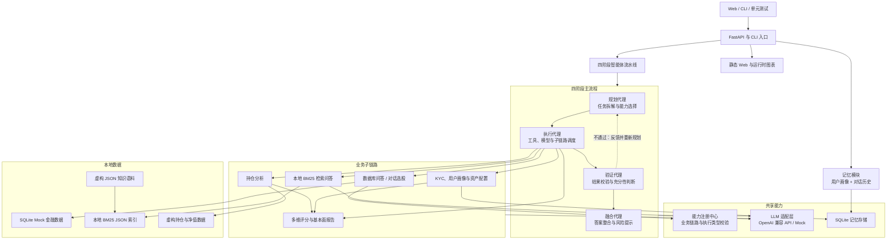
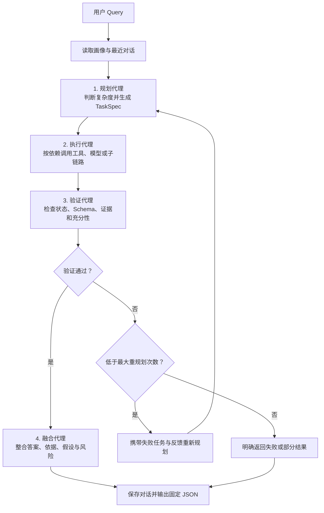

# Financial AI Advisor Agents

**多智能体金融投顾系统**。项目围绕“规划—执行—验证—融合”四阶段流水线，组织数据库问答、持仓分析、KYC 用户画像、RAG 和金融定量模型五条业务链路，并演示大模型与确定性金融小模型的协同方式。

> 文件状态：【完整可运行】<br>
> Web Demo：【完整可运行】（原生 HTML/CSS/JavaScript，已连接 FastAPI）<br>
> 核心后端：【完整可运行】（四阶段流水线、数据库问答与记忆模块）<br>
> 业务模块：【完整可运行】（持仓、KYC、RAG 与金融小模型；复杂定量逻辑【需自研理解】）<br>
> 测试基线：68 项测试通过。所有证券、行情、持仓、市场环境和知识语料均为本地测试数据

## 目录

- [项目背景](#项目背景)
- [设计目标](#设计目标)
- [核心架构](#核心架构)
- [四阶段主流程](#四阶段主流程)
- [功能范围与实现状态](#功能范围与实现状态)
- [子链路说明](#子链路说明)
- [大小模型协同](#大小模型协同)
- [提示词设计范式](#提示词设计范式)
- [项目结构](#项目结构)
- [Web 交互 Demo](#web-交互-demo)
- [快速开始](#快速开始)
- [HTTP API](#http-api)
- [独立 Agent 与示例](#独立-agent-与示例)
- [测试与独立运行](#测试与独立运行)
- [实现边界](#实现边界)
- [数据与隐私](#数据与隐私)
- [合规与免责声明](#合规与免责声明)

## 项目背景

本项目是对实习期间参与过的“大模型投顾”方向项目进行的**个人学习性质独立重实现**。

- 与原雇主或任何公司均无关联，不代表任何公司的产品或技术方案。
- 不使用原项目源代码、内部链接、内部截图或不可公开的方案原文。
- 功能范围仅依据已抽象整理的需求规格，代码、提示词和 Mock 数据均重新设计。
- 项目不包含真实交易、券商账户连接、实盘行情承诺或收益保证。

## 设计目标

- **四阶段闭环**：任务可以经过验证后退回重新规划，而不是一次性串联多个 Agent。
- **Agent 可独立测试**：每个 Agent 都具有明确输入、固定 JSON 输出和最小单元测试。
- **大小模型分工**：LLM 负责推理和生成，金融小模型负责可复核的定量计算。
- **提示词与代码分离**：所有提示词集中在 `prompts/`，遵循统一结构和输出约束。
- **默认可离线演示**：通过 Mock LLM、SQLite、本地 BM25 和虚构金融数据降低运行门槛。
- **可替换模型提供方**：通过 OpenAI 兼容 API 接入 LLM，密钥仅从环境变量读取。
- **前后端真实联调**：浏览器通过 HTTP API 调用同一套 Python 服务，不再使用固定页面响应。
- **结果有据可查**：SQL、检索片段、模型中间结果和图表 URL 作为证据进入验证与融合阶段。

## 核心架构



### 模块边界

| 模块 | 主要职责 |
|---|---|
| 四阶段流水线 | 规划、执行、验证、重规划和最终融合 |
| 数据库问答 | Query 扩写、实体对齐、Text2SQL、查询与图表生成 |
| 持仓分析 | 持仓标准化、可选 OCR、收益归因、风险诊断和组合优化 |
| KYC 与画像 | 五题状态机、画像持久化、约束检查和教育性资产配置 |
| RAG | 离线分词与 BM25 索引、在线标签过滤、检索与带引用回答 |
| 金融小模型 | 多维评分、基本面风险、收益归因、组合风险与优化 |
| 能力注册中心 | 统一注册业务链路并校验规划输出和执行类型 |
| 记忆模块 | 保存明确填写的用户画像与有限对话历史 |
| FastAPI | 提供业务 API、静态 Web 和运行时图表访问 |

## 四阶段主流程



| Agent | 输入 | 输出 | 责任边界 |
|---|---|---|---|
| 规划代理 | Query、画像、历史、能力清单、修正反馈 | `Plan` | 只选择已注册能力，不伪造工具或数据 |
| 执行代理 | Plan、前序任务结果 | `TaskResult[]` | 按依赖执行并记录证据，不自行改变任务目标 |
| 验证代理 | Query、Plan、TaskResults | `ValidationResult` | 决定进入融合或退回规划，不修补业务数据 |
| 融合代理 | 已验证任务结果 | `FinalResponse` | 不调用新工具，不使用未通过验证的结论 |

默认最大重规划次数为 `2`。重试耗尽后必须返回未完成原因，不能为了生成完整回答而编造结果。

## 功能范围与实现状态

| 功能 | 范围 | 当前状态 |
|---|---|---|
| Web 交互 Demo | 五个业务页面、真实 API、动态图表、KYC 与 Agent 轨迹 | 【完整可运行】 |
| 四阶段主流程 | 规划、执行、验证、重规划、融合 | 【完整可运行】【需自研理解】 |
| 数据库问答 | Query 扩写、指标抽取、Text2SQL、执行、后处理 | 【完整可运行】【需自研理解】 |
| 对话选股 | 内部任务规划、语义分析、SQL 生成与执行 | 【完整可运行】 |
| 持仓分析 | 示例持仓、可选 PaddleOCR、归因、风险、诊断与优化 | 【完整可运行】【需自研理解】 |
| KYC 与画像 | 五题 SOP、画像恢复、虚构市场环境和资产配置 | 【完整可运行】 |
| RAG | 离线 BM25 索引、在线标签检索和引用回答 | 【完整可运行】 |
| 金融小模型 | 多维评分、归因、组合优化、基本面与风险 | 【完整可运行】【需自研理解】 |
| 记忆模块 | 用户画像与对话历史持久化 | 【完整可运行】 |
| HTTP API | 业务接口、输入校验、静态 Web 与图表托管 | 【完整可运行】 |

## 子链路说明

### 1. 数据库问答与对话选股

目标链路：

```text
Query 扩写
  → 对话选股任务规划
  → 指标实体抽取
  → 数据库实体对齐 + 最小 Schema 拼接
  → Text2SQL
  → SQL 安全校验与执行
  → 数据后处理与图表生成
```

对话选股内部保持五个顶层组件：

1. 任务规划代理；
2. 语义分析代理；
3. Text2SQL 代理；
4. SQL 执行代理；
5. 数据后处理。

指标实体抽取器作为语义分析内部的 NLP 组件。SQL 执行层使用 AST 校验限制为**单条只读 SELECT**，并校验表字段白名单和返回行数。图表通过 `/charts/<filename>` 访问，API 不向前端暴露服务器本地绝对路径。

示例问题：

```text
筛选出 RSI 超卖且均线多头排列的股票，并整理为表格。
```

所有查询默认针对虚构 SQLite 数据，结果不能解释为真实市场行情。

### 2. 持仓分析

```text
内置 JSON 示例或图片
  → 字段标准化 / 可选 PaddleOCR
  → 低置信度字段标记
  → 持有期收益与主动收益归因
  → 波动、回撤、VaR 与集中度计算
  → 阈值诊断
  → 可选均值—方差组合优化
  → 诊断报告与优化权重
```

- 内置示例是结构化 JSON，**不伪装成 OCR 结果**。
- 图片上传只接受 PNG/JPEG，大小上限为 10 MB。
- OCR 未确认的证券名称、数量或成本保留为空值或待确认状态，不猜测补齐。
- 收益归因采用持有期算术收益，不是多期 Brinson 归因。
- 风险指标包含年化波动率、最大回撤、历史 VaR95、HHI、单券和行业集中度。
- 优化器使用投影梯度与有界单纯形投影，满足长仓、权重和为 1、单标的上限和现金下限约束。
- 优化结果只说明样本数据和目标函数下的数学结果，不是调仓指令。

### 3. KYC、用户画像与资产配置

五题 SOP 覆盖：

1. 投资经验；
2. 亏损反应；
3. 固定支出资金流向；
4. 固定支出占比；
5. 投资期限。

```text
开始或恢复 KYC
  → 单题作答与 SQLite 状态保存
  → 风险评分与完整性检查
  → 期限、支出与风险约束
  → 股票 / 基金 / 现金配置
  → 虚构市场环境与假设说明
```

画像字段只由用户明确回答更新，普通聊天历史不会自动改变风险承受能力。KYC 未完成时，主流程只返回进度和下一题，不提前生成配置。

市场环境固定输出：

```json
{
  "economic_cycle": "虚构弱复苏情景，仅用于规则演示",
  "market_interest_rate": "虚构中性利率情景，非实时利率",
  "policies_and_regulations": "未接入政策资讯，不生成实时政策判断"
}
```

这些字段是演示配置解释所需的**虚构情景**，不是实时宏观、利率或政策分析，也不用于收益预测。

### 4. RAG

离线流程：

```text
虚构 JSON 语料 → 文本切分 → 中文 bigram + 英文/数字分词
→ BM25 统计 → 本地 JSON 索引
```

在线流程：

```text
用户问题 → 受控标签获取 → 标签过滤
→ BM25 相似度检索 → Top-K 证据片段
→ 相关句抽取 → 带 [1] / [2] 引用答案
```

- 当前实现是**本地 BM25 检索**，不是神经向量库，也不声称使用 Embedding。
- 当前语料格式为 JSON，不提供 DOC/PDF 文本解析器。
- 检索分数不足时返回 `insufficient_evidence` 和空引用，不用模型记忆补造事实。
- 页面展示引用来源、页码/位置和检索分数，便于追溯。

### 5. 金融小模型

多维评分对 6 只虚构证券做横截面 Min-Max 标准化：

| 维度 | 计算口径 |
|---|---|
| 估值 | 60% 反向 PE + 40% 反向 PB |
| 质量 | 40% 毛利率 + 35% EPS + 25% 反向资产负债率 |
| 技术 | RSI、均线、MACD 与布林位置的组合规则 |
| 股息 | 股息率横截面标准化 |
| 综合 | 30% 估值 + 30% 质量 + 25% 技术 + 15% 股息 |

基本面报告同时返回输入摘要、评分、风险标记和计算假设。模型输出可重复计算，大模型不自行改写数值。

## 大小模型协同

| 大模型负责 | 小模型或确定性程序负责 |
|---|---|
| 意图理解与复杂度判断 | SQL 安全校验和 SQLite 执行 |
| 任务规划与 Query 扩写 | 数据库实体匹配与 Schema 裁剪 |
| 指标实体抽取与语义理解 | OCR 推理与持仓字段解析 |
| 充分性判断和最终答案融合 | 指标、归因、风险和组合优化计算 |
| RAG 标签获取与答案生成 | 文档切分、BM25 索引和相似度检索 |

金融模型输出包含输入摘要与关键中间值，避免大模型自行推算或改写数值。默认 Mock LLM 使用确定性规则，便于离线复现；真实 OpenAI 兼容服务需要使用者自行验证结构化输出兼容性。

## 提示词设计范式

所有提示词集中放在 `prompts/`，与 Python 代码分离，并统一采用：

```text
#角色
#任务步骤
输出格式参考
#任务要求
```

共同要求：

1. 输出固定 JSON，不使用 Markdown 代码块包裹；
2. 未提及的字段按 Schema 输出空值；
3. 只提取清单中已经列出的实体，未列出的不提取；
4. 不增加 Schema 之外的字段；
5. JSON 解析或 Pydantic 校验失败时，不将原始文本直接传入下游。

指标实体范围包括规格定义的基本面指标与技术面指标，例如资产负债率、毛利率、每股收益率、股息率、MACD 金叉、布林线轨道、均线多头排列和 RSI 超卖等。

## 项目结构

```text
financial-ai-advisor-agents/
├── configs/                         # 应用配置与金融 Schema
├── data/mock/                       # 虚构证券、指标、持仓与知识语料
├── docs/screenshots/                # Web 页面实拍图
├── prompts/                         # LLM Agent 提示词
├── web/                             # 原生 Web 前端
│   ├── index.html                   # 五个业务场景与 Agent 运行视图
│   ├── styles.css                   # 响应式机构蓝金界面
│   ├── app.js                       # API 调用与动态渲染
│   └── preview.png                  # 首页预览图
├── src/financial_ai_advisor_agents/
│   ├── agents/                      # 四阶段主 Agent
│   ├── workflows/                   # 主流程编排与有限重规划
│   ├── database/                    # Schema 注册、SQL AST 防护和 SQLite
│   ├── database_qa/                 # 数据库问答与对话选股
│   ├── portfolio/                   # 持仓、OCR、归因、风险与优化
│   ├── kyc/                         # KYC 状态机与资产配置
│   ├── rag/                         # BM25 索引、检索与引用回答
│   ├── financial_models/            # 多维评分与基本面报告
│   ├── tools/                       # 能力注册与类型校验
│   ├── memory/                      # 用户画像与对话历史
│   ├── llm/                         # OpenAI 兼容 API 与 Mock
│   ├── schemas/                     # Pydantic 数据契约
│   ├── api.py                       # FastAPI 路由与静态资源
│   ├── app.py                       # 依赖组装与能力注册
│   └── cli.py                       # 主流程、数据库、服务与独立 Agent 入口
├── examples/                        # 主流程、数据库与独立 Agent Demo
├── scripts/                         # Mock 数据初始化
└── tests/                           # 单元、API 与链路集成测试
```

## Web 交互 Demo

`web/` 是无需 npm 依赖的响应式前端，采用深海军蓝、金融蓝与香槟金配色。FastAPI 同时托管页面、业务 API 和运行时图表，五个页面均调用真实 Python 服务。

### 智能投顾工作台

展示四阶段 Agent 时间线、任务清单、预置业务入口与金融问题输入区。


### 持仓分析

展示标准化持仓、组合风险评分、行业配置、持仓明细、收益归因、诊断与模型优化权重。


### 知识库问答

展示检索标签、回答正文、BM25 相关分数和引用片段。


### 页面与交互

- **智能投顾工作台**：调用 `/api/pipeline`，动态展示规划、执行、验证、融合、任务证据和最终答案。
- **对话选股**：调用 `/api/database`，展示指标实体、Text2SQL、RSI 图表、结果表格、空结果和链路追踪；每行可继续查询真实基本面报告。
- **持仓分析**：调用示例分析或图片上传 API，展示收益归因、行业配置、风险指标、诊断和优化结果。
- **KYC 与配置**：完成五道交互问题，刷新后可恢复进度；完成后显示风险画像、资产比例和虚构市场环境。
- **知识库问答**：调用本地 BM25 服务，显示引用和证据不足状态。

界面动态文本经过 HTML 转义；图表只接受 `/charts/` 前缀 URL。选择本地图片会按用户操作上传到本地 API；未安装 PaddleOCR 时页面明确返回依赖缺失提示，不生成伪造 OCR 内容。

## 快速开始

以下命令适用于完整 Web、FastAPI、四阶段流水线、数据库问答和独立 Agent。默认 `mock` 模式不需要 API Key，也不会调用外部 LLM。

### 环境要求

- Python 3.10+
- Git
- 可选：OpenAI 兼容 API
- 可选：PaddleOCR 运行环境；未安装时仍可使用内置持仓示例

### 安装

```bash
git clone https://github.com/MEIQI-Lee/financial-ai-advisor-agents.git
cd financial-ai-advisor-agents
python -m venv .venv
```

激活虚拟环境：

```bash
# Git Bash / Linux / macOS
source .venv/bin/activate

# Windows PowerShell
# .venv\Scripts\Activate.ps1
```

安装依赖并初始化 Mock 数据：

```bash
python -m pip install -e ".[dev]"
python scripts/build_mock_data.py
```

### 环境变量

复制配置示例：

```bash
cp .env.example .env
```

支持的变量：

| 变量 | 用途 | 默认建议 |
|---|---|---|
| `APP_MODE` | `mock` 或 `openai` | `mock` |
| `OPENAI_API_KEY` | OpenAI 兼容 API 密钥 | 仅从环境读取 |
| `OPENAI_BASE_URL` | OpenAI 兼容服务地址 | 按服务方配置 |
| `OPENAI_MODEL` | Chat 模型名称 | 按服务方配置 |
| `FINAGENT_MAX_REPLANS` | 验证失败后的最大重规划次数 | `2` |
| `FINAGENT_MAX_ROWS` | SQL 最大返回行数 | `50` |
| `FINAGENT_RUNTIME_DIR` | 可写运行目录，保存 SQLite、索引与图表 | 源码安装为 `runtime/`；普通安装为当前目录下的 `runtime/` |

代码中不得硬编码 API Key，也不应提交 `.env`。OpenAI 兼容适配器已经实现，但本机验证使用 Mock 模式；接入第三方服务时仍需自行完成兼容性与结构化输出测试。

### 启动完整 Web 与 API

```bash
finagent serve --host 127.0.0.1 --port 8000
```

也可以使用模块入口：

```bash
python -m financial_ai_advisor_agents serve --host 127.0.0.1 --port 8000
```

浏览器访问 `http://127.0.0.1:8000`。不要再使用 `python -m http.server` 作为完整 Demo 的启动方式，因为纯静态服务器无法提供 Python API。

### 运行主流程

```bash
finagent pipeline \
  --user-id demo-user \
  --query "筛选出 RSI 超卖的股票，并说明筛选依据"
```

也可以尝试：

```text
分析示例持仓的收益归因、风险和优化权重
完成我的 KYC 并给出教育性资产配置
什么是分散投资？请给出知识库引用
计算虚构证券的多维评分和综合排名
```

## HTTP API

| 方法 | 路径 | 用途 |
|---|---|---|
| GET | `/api/health` | 服务健康检查 |
| GET | `/api/models/capabilities` | 已注册能力清单 |
| POST | `/api/pipeline` | 四阶段主流程 |
| POST | `/api/database` | 数据库问答与对话选股 |
| GET | `/api/portfolio/sample` | 获取并分析内置虚构持仓 |
| POST | `/api/portfolio/analyze` | 分析标准化持仓 JSON |
| POST | `/api/portfolio/upload` | 上传 PNG/JPEG 并调用可选 OCR |
| GET | `/api/financial/scores` | 多维评分与综合排名 |
| GET | `/api/financial/fundamental/{symbol}` | 单只虚构证券基本面报告 |
| POST | `/api/kyc/start` | 新建或重新评估 KYC |
| GET | `/api/kyc/status` | 查询或恢复 KYC 状态 |
| POST | `/api/kyc/answer` | 提交当前题答案并保存进度 |
| POST | `/api/rag` | 本地 BM25 检索与引用回答 |

静态页面位于 `/`，运行时图表位于 `/charts/<filename>`。API 对未知证券、非法文件类型、超大上传和缺失 OCR 依赖返回明确错误，不将异常伪装成成功结果。

## 独立 Agent 与示例

```bash
# 完整数据库问答：实体抽取、Text2SQL、执行与 PNG 图表
python examples/database_qa.py
finagent database --query "筛选资产负债率低于40%的股票"

# 独立规划 Agent
python examples/run_agent.py planner --query "分析 RSI 超卖且均线多头排列的股票"

# 独立指标抽取 Agent，输出固定 JSON 数组
python examples/run_agent.py metric_extraction --query "筛选出布林线下轨突破的股票"

# 独立 Text2SQL Agent
python examples/run_agent.py text2sql --query "RSI 超卖且均线多头排列"
```

如需真实图片 OCR，可额外安装可选依赖：

```bash
python -m pip install -e ".[ocr]"
```

PaddleOCR 模型、版本和平台兼容性需要使用者自行验证。当前自动化测试覆盖 OCR 适配器的行解析与缺依赖分支，但本机未安装 PaddleOCR，未声称完成真实模型推理验收。

## 测试与独立运行

当前测试基线为 **68 passed**。运行测试：

```bash
pytest
pytest tests/unit/agents/test_planner.py
pytest tests/unit/database_qa/test_text2sql_agent.py
pytest tests/integration/test_pipeline.py
pytest tests/integration/test_api.py
```

前端 JavaScript 语法检查：

```bash
node --check web/app.js
```

重点测试分支：

- 简单与复杂 Query 的规划结果，以及五类业务能力路由；
- 验证不通过后的重规划与最大重试耗尽；
- 非 SELECT、多语句、未授权表字段的 SQL 拦截；
- 指标实体未提及时输出空值；
- 空查询结果、图表生成、执行依赖与失败任务跳过；
- 持仓收益归因、风险指标、优化约束和 OCR 行解析；
- KYC 五题状态、刷新恢复、重新评估、配置约束与市场环境；
- RAG 离线索引、标签过滤、引用和证据不足；
- 金融多维评分、基本面报告与未知证券错误；
- FastAPI 业务接口、静态 Web、上传校验和统一错误响应。

已使用本地浏览器对五个页面进行联调，包括数据库空结果、图表访问、示例持仓、优化权重、KYC 刷新恢复、RAG 有/无证据、基本面报告、OCR 缺依赖提示和窄屏横向溢出检查。类型检查和单元测试不能替代外部模型、真实 OCR 或生产环境验收。

## 实现边界

- 默认 LLM 是确定性 Mock，不是远程大模型；OpenAI 兼容适配器可配置，但第三方服务需另行验收。
- RAG 是 BM25 本地检索，不是向量数据库；语料为 JSON，不包含 DOC/PDF 解析器。
- KYC 市场环境是固定虚构情景，不连接实时宏观、利率或政策数据。
- 持仓归因是持有期算术收益归因，不是多期 Brinson；组合优化是教学用均值—方差实现。
- PaddleOCR 适配器已实现，真实模型推理需要安装可选依赖并另行测试。
- 不包含实时行情、券商账户、交易下单、自动调仓或收益承诺。
- 浏览器页面使用同一套本地 API；截图用于界面展示，具体运行结果以当前输入和本地数据为准。

## 数据与隐私

- 默认金融数据全部为虚构 Mock 数据，不对应真实证券或真实收益。
- RAG 语料为项目自编演示内容；扩展公开资料时应确认许可并记录来源。
- 记忆、Mock 查询和 BM25 索引均保存在本地运行目录。
- 不建议在 Demo 中上传真实身份证、银行卡、券商账户或其他敏感信息。
- 如接入第三方 LLM 或 OCR 服务，用户需要自行确认数据发送范围和服务条款。
- `.env`、真实持仓图片和运行时用户数据应加入 `.gitignore`。

## 合规与免责声明

1. 本项目为**个人学习性质的独立重实现**，与任何公司、金融机构或原实习项目均无关联。
2. 本项目不使用或公开任何公司内部代码、内部链接、内部截图、内部文档原文或保密信息。
3. 项目仅用于演示多智能体编排、LLM 工程化、Text2SQL、BM25 检索和金融定量模型的技术组合。
4. 所有输出均不构成投资、法律、税务或财务建议，不构成证券推荐、收益承诺或风险评估结论。
5. Mock 数据、模型输出和生成内容可能包含错误，不应作为真实交易依据。
6. 项目不提供下单、自动调仓或实盘账户操作能力。
7. 使用者应独立核验数据、公式和输出，并遵守适用的法律法规及第三方服务条款。

## License

本项目采用 MIT License，完整条款见 [LICENSE](LICENSE)。
